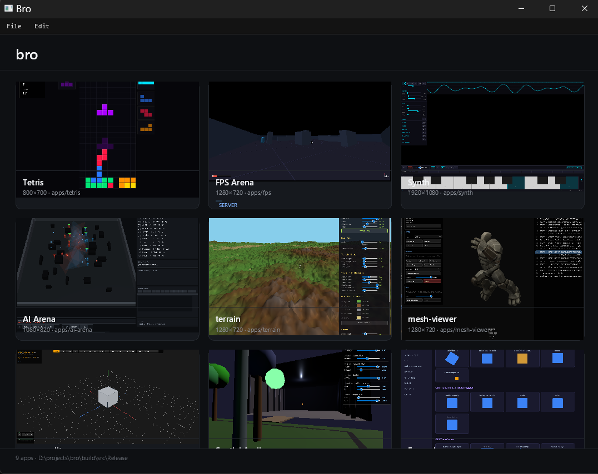

# Bro

[](https://github.com/wlejon/bro/actions/workflows/ci.yml)
[](https://github.com/wlejon/bro/actions/workflows/codeql.yml)
[](https://github.com/wlejon/bro/actions/workflows/nightly.yml)
[](https://github.com/wlejon/bro/releases/latest)
[](LICENSE)

Build desktop apps and games in **HTML/CSS/JS** with 3D, physics, real-time audio, on-device AI, single-source GPU shaders, and in-process formal verification & constraint solving — all in one native process. Custom layout engine, Skia, and Vulkan 1.3 Core. Windows, macOS, and Linux.

**\* pre-alpha \***

Each nightly zip also bundles **[bronze](https://github.com/wlejon/bronze)** (the AOT/JIT JS compiler, GPU shader compiler, and SMT prover built on **[brass](https://github.com/wlejon/brass)**). Apps run immediately from source via in-process JIT, or compile ahead of time to a native module (`app.dll`/`.so`/`.dylib`) via `bronze build`.

## What is it?

Four capabilities unified inside a single native binary sharing one compiler IR and one bitvector SMT solver:

- **Chromium-class UI layer** — HTML5, CSS (flexbox, grid, gradients, animations), SVG, Canvas 2D, WebGL 2.0, Web Components, HarfBuzz text shaping.
- **Godot-class game & media runtime** — 3D scene graph, Jolt physics, lock-free spatial audio & synthesis, SDF/CSG mesh generation, navmesh pathfinding, rollback & GNS networking.
- **On-device AI & differentiable compute** — Local LLMs, diffusion, vision, speech, 3D generation, and a custom Vulkan/CUDA tensor engine with reverse-mode JIT autodiff.
- **In-process theorem prover, superoptimizer & differentiable physics/GPU** — Because the JS compiler, SPIR-V/PTX GPU compiler, physics/audio engine, LLM, and SMT solver live in the same address space, plain JavaScript can be inverted (`bro.solve`), formally proven (`bro.prove`), symbolically differentiated (`bro.gpu.differentiate`), and superoptimized (`bro.superoptimize`) at runtime.

## Broworkshop

[broworkshop](https://github.com/wlejon/broworkshop) houses starter apps, games, and interactive studios built with `bro`:

```bash
bro broworkshop/bro.json
```



## Hello world

```html
<!-- hello/index.html -->
<h1 id="msg">Hello</h1>
<button id="btn">Click me</button>
<script>
  document.getElementById('btn').addEventListener('click', () => {
    document.getElementById('msg').textContent = 'Hello, bro';
  });
</script>
```

```bash
bro path/to/hello
```

## What you get

**1. The web app layer.** HTML5, CSS, SVG, Canvas 2D, WebGL 2.0, Shadow DOM, Web Workers, Fetch, localStorage, and HarfBuzz bidi/ligature text shaping. Unmodified `three.js` and `pixi.js` work out of the box.

**2. 3D, physics, audio & systems** — reachable directly from JS in one process with zero IPC:

| API | Capability |
|---|---|
| `bro.scene` | 3D scene graph: PBR meshes, sprites, particles, skinned characters, GPU SDF raymarching |
| `scene.createTerrain` · `createClipmapTerrain` · `createTileWorld` | Chunked height-field terrain, camera-centred clipmaps, square/hex tile grids |
| `Physics` · `bro.physics` | Jolt rigid bodies, constraints, raycasts, vehicles, SIMD $-\nabla U$ force fields (`compileForceField`), inverse trajectory solver (`solveTrajectory`) |
| `AudioContext` · `bro.audio` | Real-time synthesis, spatial audio, MIDI, and formally verified lock-free JS DSP kernels (`compileDspKernel`) |
| `bro.mesh` · `bro.ai.game` · `bro.flora` | SDF/CSG mesh generation & inverse SDF fitting (`solveSDF`) · navmesh + A* · procedural flora |
| `bro.net` | GNS networking, deterministic lockstep rollback (`createRollbackSession`), verified P2P code capsules (`createVerifiedCapsule`) |
| `<video>` · `VideoEncoder` · `GifEncoder` | WebM/VP9 playback and RGBA frame encoding |
| Native chrome · `bro.steam` | Native file dialogs, menu bars, gizmos, multi-window, Steamworks |

**3. On-device AI & differentiable tensors** — runs locally on Vulkan/CUDA/CPU inside the frame loop:

| API | Capability |
|---|---|
| `bro.lm` | Local LLMs (Qwen3, Qwen3.5, Mistral), SMT-guided grammar repair (`createVerifiedValidator`), neuro-symbolic verified code synthesis (`synthesizeVerifiedFunction`) |
| `bro.diffusion` · `bro.vision` | Image generation (U-Net/VAE, LoRA) & perception (SAM, depth, normals, matting, ControlNet) |
| `bro.triposplat` · `bro.motion` | Single-image-to-3D & text-to-animation |
| `bro.tts` · `bro.stt` · `bro.diar` · `bro.rave` | Speech synthesis (Kokoro, Qwen3-TTS), ASR (Whisper, Parakeet), speaker diarization, neural audio |
| `bro.wake` · `bro.kws` · `bro.mic` · `bro.sense` · `bro.gesture` | Wake words, keyword spotting, live mic, acoustic sensing, gesture recognition |
| `bro.tensor` · `bro.image` | GPU/SIMD tensor engine with formally audited backward shaders & fused reverse-mode autodiff (`jitBackward`) |

**4. In-process verification, constraint solving & superoptimization:**

| API | Capability |
|---|---|
| `bro.solve` · `bro.solveAll` · `bro.layout.solve` | Run plain JS functions backwards via the in-process bitvector SMT solver; solve declarative UI layout constraints |
| `bro.prove` · `bro.fuzz` | Prove mathematical properties or synthesize minimal SMT counterexample inputs |
| `bro.optimize` · `bro.superoptimize` · `bro.rewriteSource` | CEGIS superoptimization and verified source-to-source JS rewriting for size and speed |
| `bro.gpu` · `bro.autoKernel` · `bro.scene.solveProcedural` | Single-source JS `@kernel`/`@shader` compilation to SPIR-V/PTX, symbolic shader autodiff (`differentiate`), inverse procedural parameter solving |
| `bro.live` · `bro.evolve` | Self-healing proof-gated live reload (`createSupervisor`) & background evolutionary kernel superoptimization |

Every `bro.*` namespace has an annotated JSDoc reference in [`docs/`](docs/) (indexed in `docs/reference.html`).

## Running & testing

```bash
# Open the project manager
bro

# Run an app in windowed mode
bro ../broworkshop/bro.json

# Run deterministically in headless mode (virtual time, GPU/CPU rendering, screenshots)
bro-headless ../broworkshop/demos/dom-lab test.js
bro-headless --no-gpu ../broworkshop/demos/dom-lab
```

See [docs/headless.md](docs/headless.md) for headless testing globals (`screenshot`, `advanceTime`, `flush`, `assert`) and [BUILDING.md](BUILDING.md) for CMake build presets and `-DBRO_PROFILE=minimal|app|desktop|full` configuration.

## Ecosystem

`bro` is organized as a set of standalone sibling repositories (`bronze`, `brass`, `brotensor`, `brolm`, `broaudio`, `bromesh`, `brodiffusion`, `brovisionml`, `brosoundml`, `broworkshop`, etc.) that build together from `../<name>` or fetch automatically at configure time. See [docs/ecosystem.md](docs/ecosystem.md) and [docs/multi-repo-workflow.md](docs/multi-repo-workflow.md).

## Warning

While `bro` implements an HTML/CSS/JS engine, it is built for native local apps and games — not browsing untrusted websites. It exposes native system, GPU, and filesystem capabilities directly to JavaScript; use `bro.net.verifyCapsule` when loading untrusted peer applets.

## License

[MIT](LICENSE). Third-party dependencies are under their respective permissive licenses in `third_party/`.
